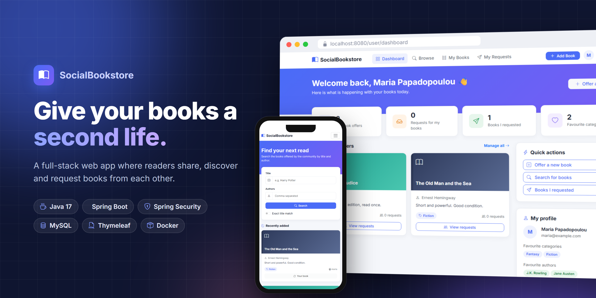
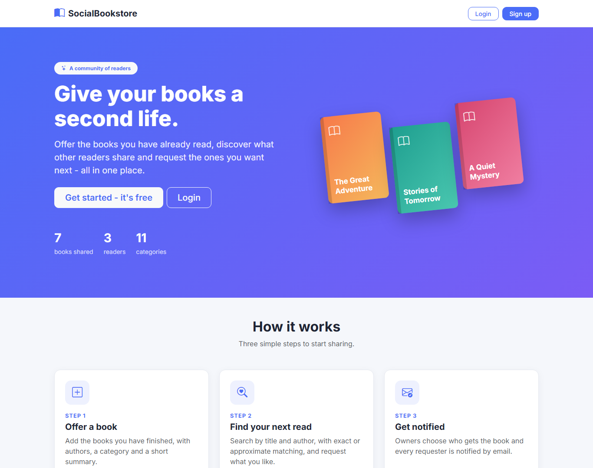
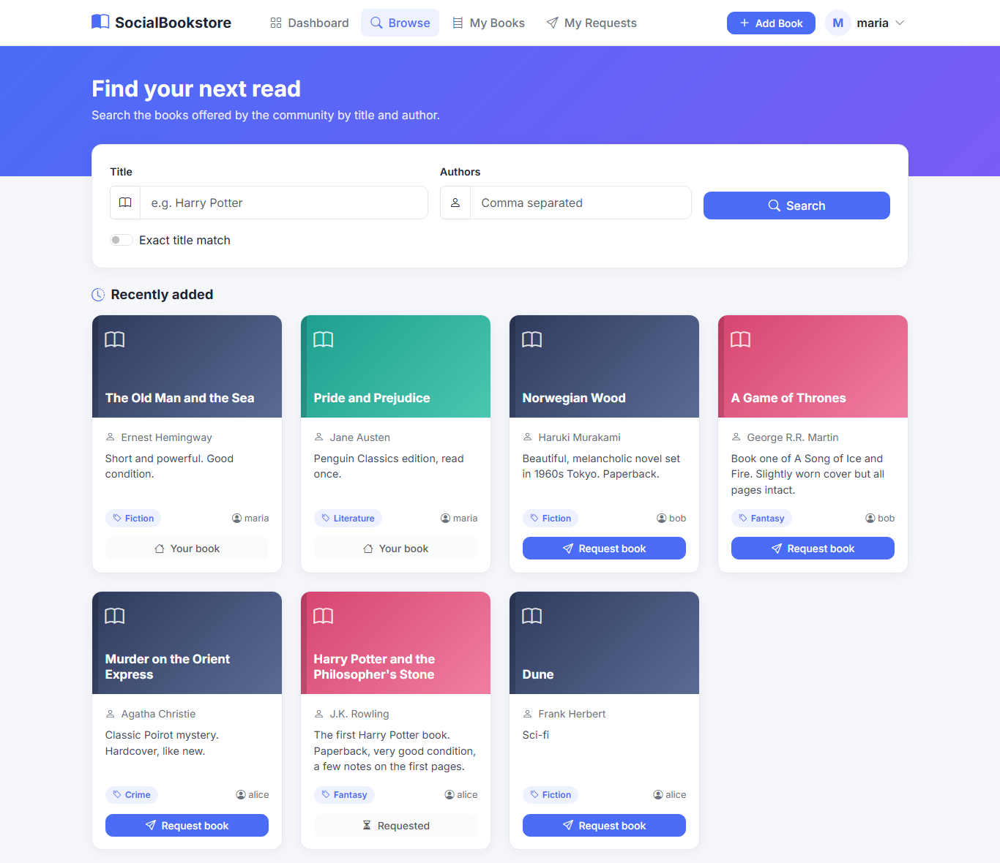
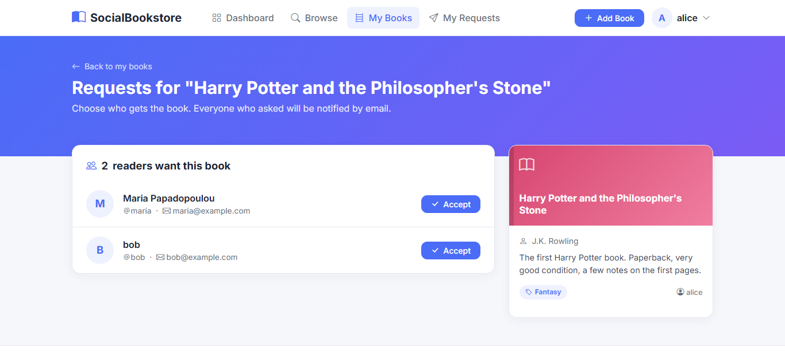
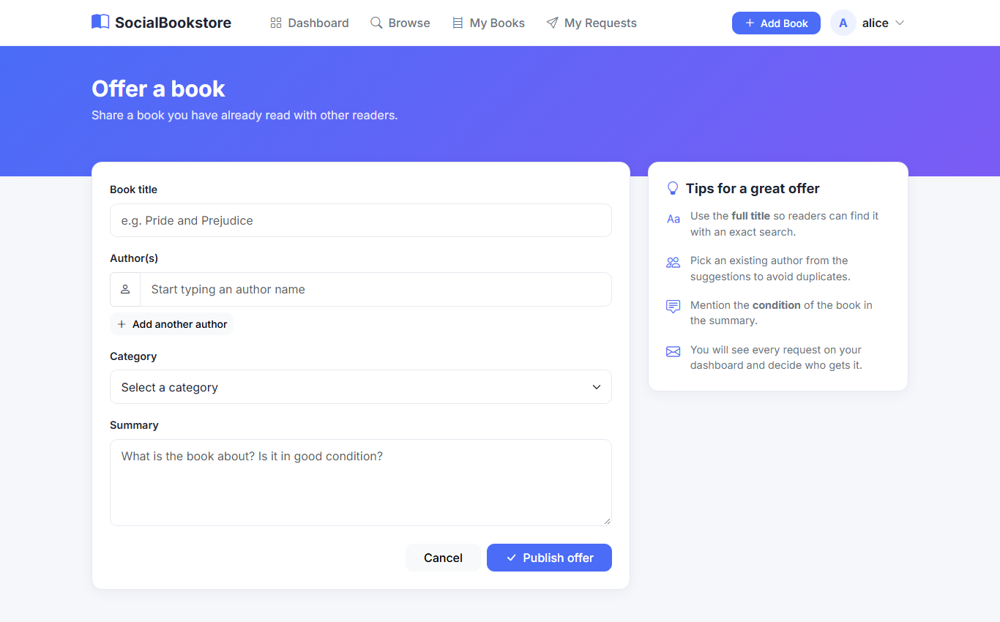

# 📚 SocialBookstore

A full-stack web application where readers **share the books they have already read**.
Users offer books, search what the community has to offer, request the ones they want,
and owners decide who gets each book - with email notifications for everyone involved.

Built with **Java 17, Spring Boot 3, Spring Security, Thymeleaf and MySQL**, fully containerized with **Docker**.



## 🚀 Quick start

The only requirement is [Docker Desktop](https://www.docker.com/products/docker-desktop/).

```bash
git clone https://github.com/Philippos793/Online-BookStore-Application.git
cd Online-BookStore-Application
docker compose up --build
```

Then open **http://localhost:8080** and create an account.

That's it - Docker builds the app, starts a MySQL database, creates the tables and loads
sample authors and categories. Nothing else to install or configure.

```bash
docker compose down      # stop (your data is kept)
docker compose down -v   # stop and delete the database
```

## ✨ Features

- **Accounts** - registration with profile, favourite categories and authors; secure login with Spring Security (BCrypt, CSRF protection, role-based access)
- **Book offers** - add books with multiple authors, a category and a summary; manage your shelf
- **Search** - by title and authors, with exact or approximate matching (Strategy / Template Method patterns)
- **Requests** - request books from other readers; owners see who asked and accept one request
- **Email notifications** - requesters are notified asynchronously when a request is submitted, accepted or rejected
- **Dashboard** - personal stats, your offers, your profile and the newest books from the community
- **Responsive UI** - Bootstrap 5 design that works on desktop and mobile

## 🖼️ Screenshots

### Landing page


### Dashboard


### Browse & search


### Managing requests for a book


### Offer a book


### Login & registration


## 🛠️ Tech stack

| Layer | Technologies |
|---|---|
| Backend | Java 17, Spring Boot 3, Spring MVC, Spring Data JPA (Hibernate), Spring Security, Spring Mail |
| Frontend | Thymeleaf, Bootstrap 5, Bootstrap Icons |
| Database | MySQL 8 |
| DevOps | Docker, Docker Compose (multi-stage build) |
| Testing | JUnit 5, Mockito |

## 🏗️ Architecture

The application follows a layered MVC architecture:

```
controllers/   HTTP endpoints and view models
service/       business logic, search strategies, async email
mappers/       Spring Data JPA repositories
domainmodel/   JPA entities (User, UserProfile, Book, BookAuthor, BookCategory)
templates/     Thymeleaf views with shared layout fragments
```

Authorization is enforced in the service layer: only a book's owner can view, accept or delete
the requests for it.

## 📧 Email notifications (optional)

Emails are sent through Gmail SMTP. To enable them, create a `.env` file next to
`docker-compose.yml`:

```properties
MAIL_USERNAME=your-email@gmail.com
MAIL_PASSWORD=your-gmail-app-password
```

Without it, everything else works normally - emails are just not delivered (the failure is only logged).

<details>
<summary><b>💻 Running without Docker</b></summary>

<br>

Requirements: Java 17+ and a running MySQL 8 server.

1. Copy the example config and fill in your MySQL credentials (this file is gitignored):

   ```bash
   cp src/main/resources/application-local.properties.example src/main/resources/application-local.properties
   ```

2. Start the application - the database and tables are created automatically:

   ```bash
   ./mvnw spring-boot:run        # Linux / macOS
   mvnw.cmd spring-boot:run      # Windows
   ```

3. Open **http://localhost:8080**

</details>

## 🧪 Tests

```bash
./mvnw test
```

## 📄 Project context

This project was developed as part of academic coursework, applying software engineering
principles and full-stack development practices. The original coursework documents
(requirements, guidelines, sprint report, package diagram) are in [`docs/`](docs/).
