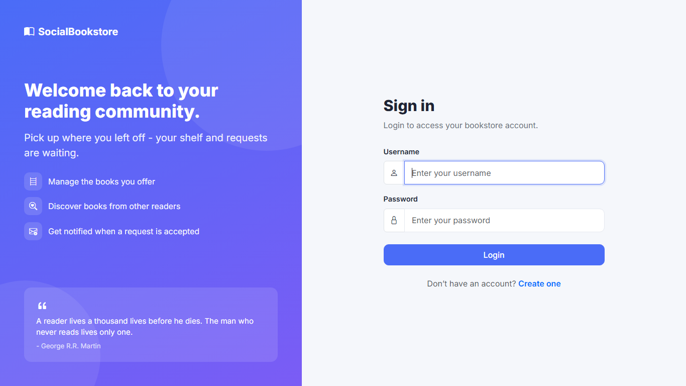
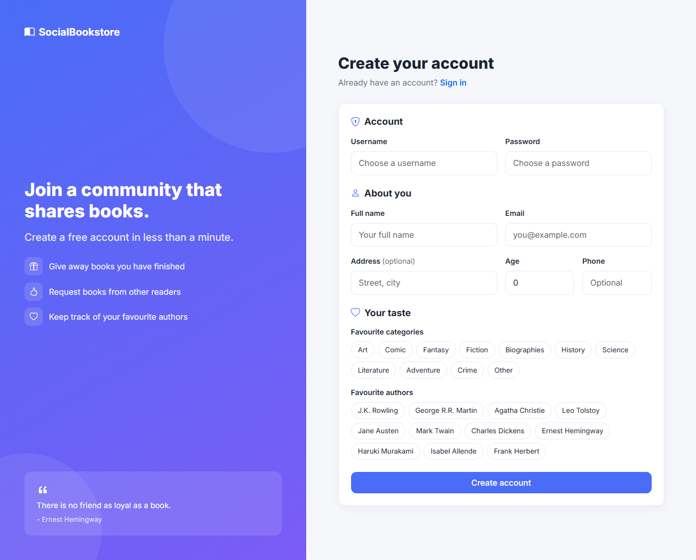

# Online Bookstore Web Application

A full-stack web application developed using **Java Spring Boot** that allows users to interact
with a digital bookstore environment. Users can register, manage their profiles, browse books,
and interact with other users through a clean and structured interface.

## Features

- User registration and login
- User authentication and authorization with Spring Security
- Profile management
- Book offer management
- Book search functionality
- HTML-based user interface
- MySQL database integration

## Application Preview

### 🔐 Login Page
Users can log in using their credentials or navigate to the registration page.



### 📝 Register Page
New users can create an account by providing their details and selecting preferred categories.



### 📚 Dashboard
Users can browse available books, manage offers, and interact with other users.


## ⚙️ How to Run

### 1. Clone the repository

```bash
git clone https://github.com/Philippos793/Online-BookStore-Application.git
```

### 2. Create the MySQL database

Before running the application, create the required database:

```sql
CREATE DATABASE IF NOT EXISTS secure_users_directory;
```

Run the initialization scripts:

`database/init.sql`
`database/data.sql`

### 3. Configure database credentials

Credentials are never committed. Copy the example file and fill in your own values:

```bash
cp src/main/resources/application-local.properties.example src/main/resources/application-local.properties
```

```properties
spring.datasource.username=YOUR_DB_USERNAME
spring.datasource.password=YOUR_DB_PASSWORD

# optional - only needed for the email notifications
spring.mail.username=YOUR_EMAIL
spring.mail.password=YOUR_APP_PASSWORD
```

`application-local.properties` is gitignored. Alternatively, set the environment variables
`DB_USERNAME`, `DB_PASSWORD`, `MAIL_USERNAME` and `MAIL_PASSWORD`.

### 4. Run the application

For Windows:

```bat
mvnw.cmd spring-boot:run
```

For Linux / macOS:

```bash
./mvnw spring-boot:run
```

Run the tests with `mvnw.cmd test` (or `./mvnw test`).

### 5. Open in browser

```text
http://localhost:8080
```

## Technologies Used

- Java
- Spring Boot
- Spring Security
- MySQL
- HTML
- Git / GitHub

## Architecture

The application follows an MVC-based structure, separating controllers, views, models, services,
and data access logic to improve maintainability and code organization.


## Project Context

This project was developed as part of academic coursework,
applying real-world software engineering principles and full-stack development practices.

## Project Documents

The original coursework documents (requirements, guidelines, sprint report, package diagram)
are in [`docs/`](docs/).
